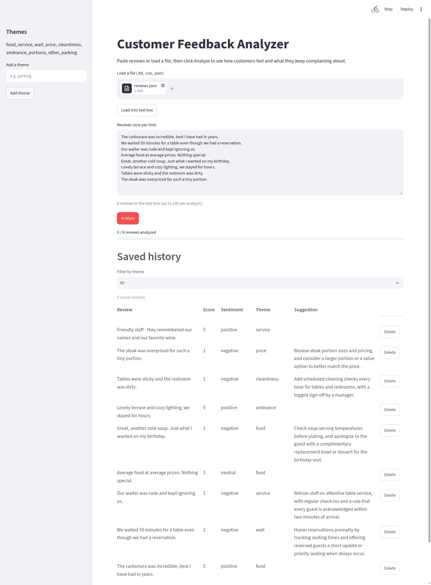

# Customer Feedback Analyzer

Paste restaurant reviews or load a file, click Analyze, and see how customers feel and what they keep
complaining about. Results can be saved to a local SQLite database to build a history of feedback.



## How it works

- Each review gets a **score 1-5** and one **theme** from an editable list (food, service, wait, price, ...).
  Sentiment (negative / neutral / positive) is derived from the score in code.
- Negative reviews also get a one-line **suggestion** on how to fix the problem.
- The summary shows review count, average score, percent positive, the most mentioned theme and the top complaint.
- Models run through [OpenRouter](https://openrouter.ai) with strict JSON-schema output, so the model is a setting.
- Inputs: paste, `.txt`, `.csv`, `.json` / JSON Lines (samples in `samples/`). Up to 100 reviews per analysis.

## Setup

Requires [uv](https://docs.astral.sh/uv/) and an OpenRouter API key.

```bash
uv sync
cp .env.example .env        # then set OPENROUTER_API_KEY
uv run uvicorn app.main:create_app --factory    # API on :8000
uv run streamlit run ui/app.py                  # UI on :8501 (second terminal)
```

Review text is sent to OpenRouter and the model provider. Use fictional or consented data.

## Tests

```bash
uv run pytest               # offline, OpenRouter mocked
uv run pytest -m live       # real API call, costs a fraction of a cent
uv run python -m eval.bakeoff   # compare models on the labeled set
```

## Model choice

`eval/dataset.jsonl` holds 100 synthetic reviews with known scores and themes, including sarcasm,
mixed opinions, typos, emoji, one-liners, non-English and off-topic reviews. The bake-off runs each
candidate through the real pipeline; full table in [docs/bakeoff.md](docs/bakeoff.md).

| Candidate | Label acc | Cost / 100 reviews | Time (100 reviews) |
|---|---|---|---|
| GPT-6 Luna, low reasoning (default) | 99% | $0.0018 | 6.0 s |
| Claude Haiku 5.5, low reasoning | 95% | $0.0021 | 2.7 s |
| DeepSeek V4.1 Flash | 100% | $0.0047 | 16.9 s |
| Jev Router | 100% | $0.0420 | 26.1 s |

Every candidate met every target, so the default follows the pre-set rule (cheapest that meets all).
Jev Router was 10-20x more expensive here and answered from three different models in one run.

## Limitations

- One theme per review: a mixed review ("great food, awful service") is filed under its dominant theme.
- The test set is synthetic and easy; real reviews will score lower. Treat the table as a smoke test, not a benchmark.
- Jobs live in memory and are lost when the API restarts. Saved reviews are kept in `feedback.db`.
- The Jev classifier (a non-generative model from TypeSafe) is not integrated: it is not on OpenRouter
  and its API is in limited early access. The analyzer interface in `app/analyzers/` is where it would plug in.

## Docs

[spec](docs/spec.md), [architecture](docs/architecture.md), [plan](docs/plan.md).
